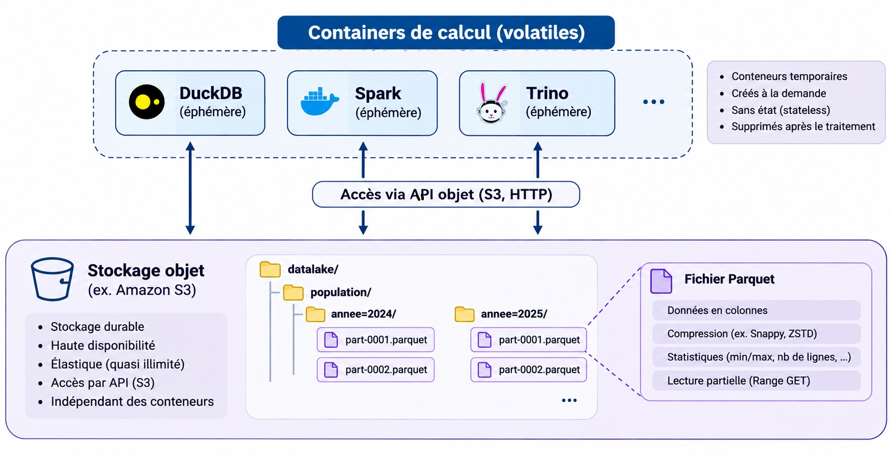
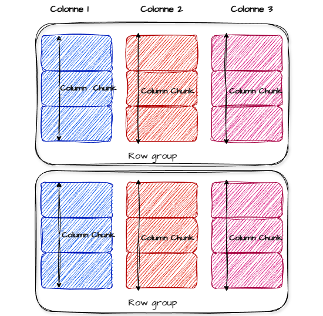
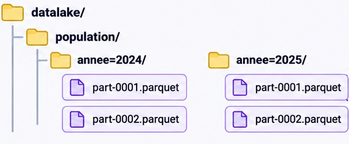
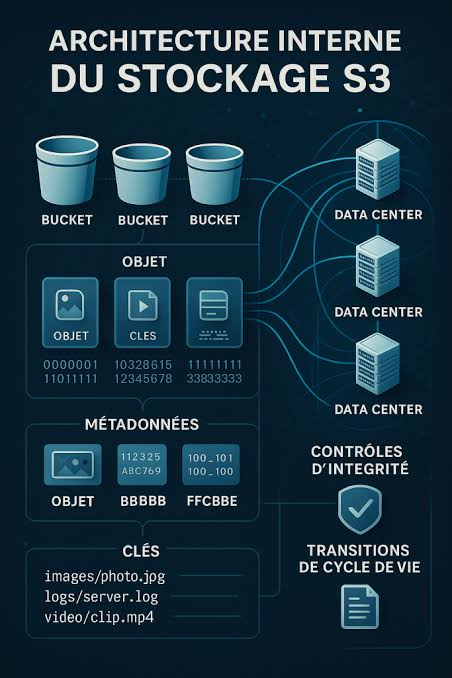
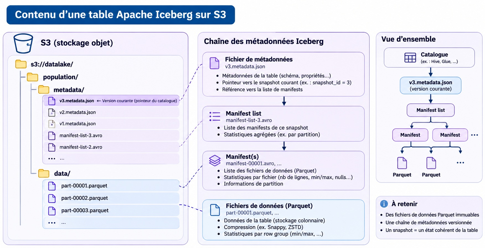
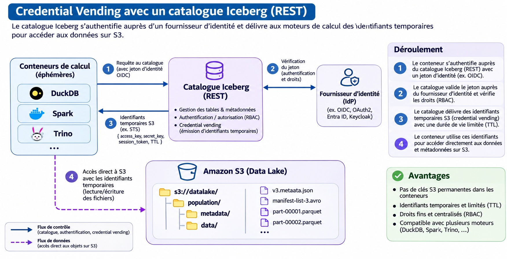
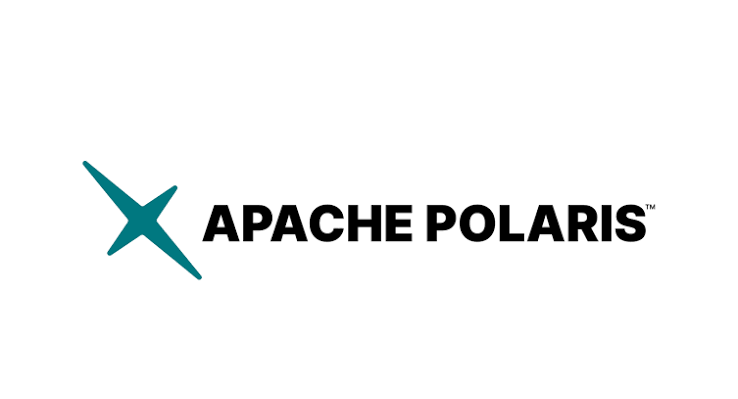

## Une architecture data 

{width="15%"}

---

## Le format de fichier parquet  

:::: {.columns}

::: {.column width="50%"}
 

2013 - ecosystème big data (hadoop) 

 

- format de fichier orienté colonnes
- compressé
- row group
- Métadonnées, statistiques
:::

::: {.column width="50%" style="text-align: right;"}
{width="100%"}
:::
::::
---

## Le format de fichier parquet  

 

:::: {.columns}

::: {.column width="40%"}

 
 
 

- predicate pushdown
- partitionnement
- requêtes range
:::

::: {.column width="60%"}

 

{width="100%"}
:::
::::

::: {.notes}
{width="10%"}

optimisation (min max) : row group (le mieux c de pas y toucher) = plus petite unité de fichier accédée par un moteur de calcul : lecture des métadonnées (si bcp, fichier de metadonnées + gros donc attention)
le partitionnement : stockage dans des dossiers 
prédicat pushdown
warning ! comment faire de la sélection dans un fichier ? -> requêtes range 
! sur s3 très mauvais d'avoir pleins de petits fichiers (car le fetch coûte cher)
bonne taille = à partir de 500 Mo

:::

::: {.notes}
Le message important : Parquet optimise la lecture et le stockage d'un fichier. Il ne gère pas, à lui seul, les transactions d'une table constituée de milliers de fichiers.
:::
---

## S3 - stockage objet

Un protocole qui implémente les principes du stockage objet
 
Serveur s3 + bucket + path (objet) :
 
`https://minio.lab.sspcloud.fr/donnees-insee/diffusion/RP/2017/individu_reg/individu_reg.parquet`
 

::: {style="text-align: center;"}
{width="50%"}
:::

::: {.notes}

Monde big data ~ colocalisation du traitement et des données : si on augmente un, on doit augmenter les 2 (cpu, ram...) -> stockage d'une part et compute de l'autre & réseau qui a augmenté au cours des 15 dernières années 
pas de besoin de faire du calcul distribué à l'insee

:::

## Expérience utilisateur avec s3

 
Des chemins absolu dans le code applicatif   
 
`s3://donnees-insee/diffusion/RP/2017/individu_reg/individu_reg.parquet`  
 

- authentification basée sur un échange de token 
- stockage applicatif (http & tokens)  
- une solution économe    
- WORM : write once, read many  
- Stockage centralisé : découplage du stockage et des moteurs de calcul  

---

## Une inversion du paradigme

 

- la liste des ressources accessibles est aggrégée dans une policy attribuée à un rôle

- Sur un partage de fichiers les droits sont au niveau de chaque dossier / fichiers

=> la policy aggrégée est sensible
 
 

=> permet de cartographier l'usage des données 

:::{.notes}
: un rôle typiquement pourrait être le fait que des users ont le droit de croiser deux sources
:::

---

## Des limites  

 
 
- Pas d'écriture aléatoire   
- Pas d'atomicité sur les fichiers 

:::{.notes}
Et si on arrêtait de considérer une table comme un dossier de fichiers ?

! sur s3 très mauvais d'avoir pleins de petits fichiers (car le fetch coûte cher)
bonne taille = à partir de 500 Mo

:::

---

## Iceberg
 
Apache Iceberg est un format de table ouvert (2017)

:::: {.columns}
::: {.column width="60%"}

 

*Rappel:*  
 
- Parquet : le format des données  
- S3 : le stockage physique  
- Iceberg : le format de table et ses métadonnées
:::
::: {.column width="40%"}
 
 
{width="50%"}
:::
::::

::: {.notes}
Iceberg ne remplace ni S3 ni Parquet. Il ajoute une couche de métadonnées permettant de gérer les fichiers comme une table cohérente.
des fichiers de données dans un dossier data et un fichier metadata.json qui évolue à chaque fois qu'un client iceberg (engine d ecompute) va réécrire la table ou les diif

:::
---

## Iceberg

{width="110%"}

---

## Des apports

 

- Transactions ACID 
- Snapshots 
- Time Travel
- Évolution du schéma 
- Partitionnement évolutif : Modification de la stratégie de partitionnement sans réorganiser immédiatement tous les fichiers
- Optimisation des lectures : Utilisation des statistiques des manifests pour éviter de lire des fichiers inutiles
- Interopérabilité 

::: {.notes}

- Transactions ACID : Garantit des modifications atomiques et cohérentes au niveau d'une table
- Snapshots : Conserve des états successifs de la table
- Time Travel : Permet d'interroger un état historique
- Évolution du schéma : Ajout, suppression ou renommage de colonnes sans réécriture systématique des données
- Partitionnement évolutif : Modification de la stratégie de partitionnement sans réorganiser immédiatement tous les fichiers
- Optimisation des lectures : Utilisation des statistiques des manifests pour éviter de lire des fichiers inutiles
- Interopérabilité : Utilisation d'un même format de table par plusieurs moteurs compatibles

là c'est ACID et on n'arrive pas à faire ça donc là on a  un catalogue qui va garantir l'atomicité d'un changement de la table iceberg. 
ex : écrire à 2 sur un fichier : c'est le dernier qui a raison 
sur iceberg on peut grâce aux fichiers de métadonnées

Concrètement insertion = fait sans delete 
si on fait update ou delete : on réécrit (des bits qui disent si la ligne est supp) et sinon on crée un nouveau fichier avec la ligne supprimé 

idée : clean de temps en temps : compactage (stratégie selon ce qui nous intéresse)
:::

---

## Iceberg rest api

Apparu il y a 2 ans 

{width="90%"}

::: {.notes}
quand l'utilisateur demande une data : le serveur fait du credential vending = fournit un token et le lien vers le stockage 
utilisateur connu uniquement dans le server de catalogage
:::

---

## Le catalogue

- pointe vers le fichier de metadonnées à jour et assure la cohérence en cas d'accès concurrent

- une couche d'abstraction au stockage grâce au credential vending

Chaque client iceberg fait sa demande d'accès au catalogue, système d'habilitation propre au catalogue et de fourniture de token S3 et de cible (serveur S3 + bucket + path ) pour accéder à la donnée

L'utilisateur n'a pas de droit en propre sur S3 , il les obtient dynamiquement par le biais du serveur de catalogue qui utilise AssumeRole et peut ajouter une policy restrictive

https://docs.aws.amazon.com/fr_fr/STS/latest/APIReference/API_AssumeRole.html

:::{.notes}
Ce n'est pas nouveau, historiquement hive-metastore (ecosystème RIP big data) , pas un catalogue http , difficilement multi-tenant

Désormais le catalogue à un spécification standard et ouverte Iceberg Rest API implementé par différents logiciels comme Apache Polaris.
enfin des technos cloud native friendly

http + oidc (=> onyxia friendly)
une couche d'abstraction intéressante

:::

---

## Polaris

Un catalogue open source mettant en œuvre l'API REST Catalog Iceberg, pour permettre à plusieurs moteurs d'utiliser les mêmes tables.

- Retrouver une table à partir de son nom
- Résoudre les métadonnées courantes
- Gérer les identités, rôles et autorisations
- Éventuellement fournir des credentials temporaires pour accéder aux objets  

::: {style="text-align: center;"}
{width="30%"}
:::
---

**[Et d'un point de vue user ? ]{.bleu}**

::: {.notes}
onyxia échange le token que la personne a contre un token dynamique fourni par le stockage objet 
- contrairement à windows où les droits sont gérés par objets
- là on crée une politique d'accès et agrégée
 
opportunité + long terme :
politique agrégée = on a un gros défaut, mais un jour : j'accède qu'aux données les + sensibles et pas aux autres 
(ex: edp santé)

permet de cartographier les rôles de travail qu'on aurait

plutôt que de fournir un token avec tous les droits, c'est géré par le système 

lors de l'échange de token, on peut réduire les droits grâce à une policy 
STS assume role api 
:::

:::{.notes}
Polaris : ajout de metadonnées sur les tables pour la garder x jours ou faire du nettoyage ts les x jours 

polaris : on peut déléguer des droits : ex = le schéma rp appartient à une équipe 
 

à la base le catalogue pointe sur un fichier de metadonnées

iceberg rest api = le format et polaris = une implem

## Comment iceberg retrouve ses fichiers ? 

Slide 13 — Comment fonctionne un commit ?
1. Le moteur lit le snapshot courant.
2. Il écrit de nouveaux fichiers de données et de métadonnées.
3. Il demande la publication de la nouvelle version.
4. Le pointeur est mis à jour atomiquement, sous contrôle de concurrence.
5. En cas de conflit, l'opération échoue ou est retentée selon les règles applicables.
Introduire ici l'optimistic concurrency control. 
:::

